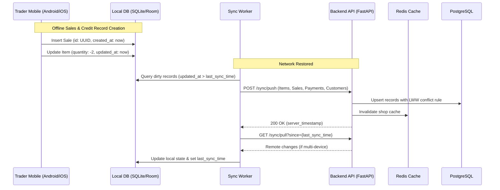

# 🏛️ Duka Ledger System Architecture

## 1. Architectural Principles
- **Offline-First for Traders**: Mobile clients (Flutter, Kotlin, Swift) operate seamlessly without network connectivity. Local SQLite/Room/CoreData is the authoritative source of truth.
- **Eventual Consistency with Conflict Resolution**: Last-Write-Wins (LWW) based on server-verified UTC `updated_at` timestamps. Soft-deletes (`is_deleted=true`) avoid phantom resurrects.
- **Feature-First Modularity**: Every platform organizes code by functional domain rather than technical layers.
- **Extreme Network & Battery Thrift**:
  - Gzip compression on all payloads.
  - Minimalistic JSON structures.
  - Aggressive 2G/3G failure recovery with exponential backoff and idempotency tokens.

## 2. Shared Data Contract (Canonical Schema)

| Model | Primary Key | Key Attributes | Sync Attributes |
|---|---|---|---|
| **Shop** | `id: UUID` | `name`, `profile_type` (duka/mama_mboga), `payment_number`, `location_id`, `language` | `updated_at`, `is_deleted` |
| **Item** | `id: UUID` | `shop_id`, `name`, `unit`, `buy_price`, `sell_price`, `quantity`, `low_stock_level` | `updated_at`, `is_deleted` |
| **Customer** | `id: UUID` | `shop_id`, `name`, `phone`, `credit_limit`, `trust_score` | `updated_at`, `is_deleted` |
| **Sale** | `id: UUID` | `shop_id`, `customer_id` (nullable), `type` (cash/credit), `total`, `items` (JSON) | `created_at` |
| **Payment** | `id: UUID` | `customer_id`, `amount`, `method` (cash/mpesa), `mpesa_code` (optional) | `created_at` |
| **Location** | `id: UUID` | `county`, `area`, `estate` | Master Directory |

## 3. Distributed Sync Flow

